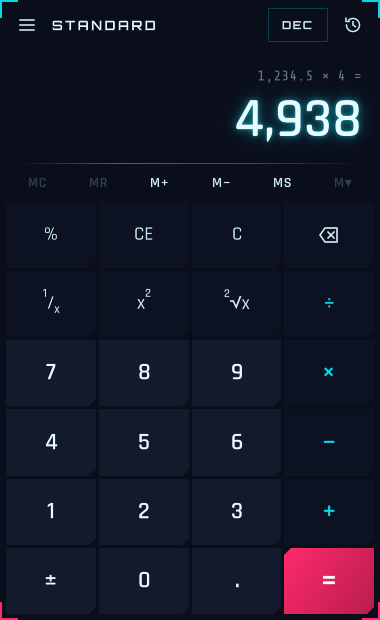
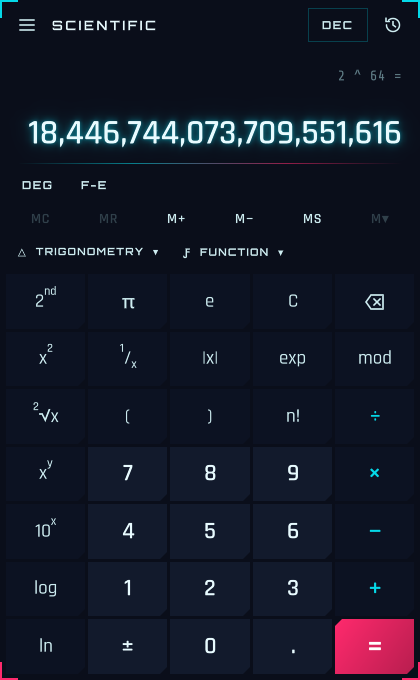
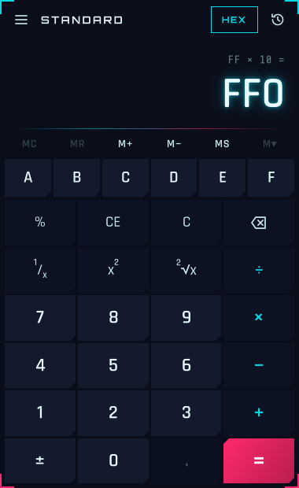
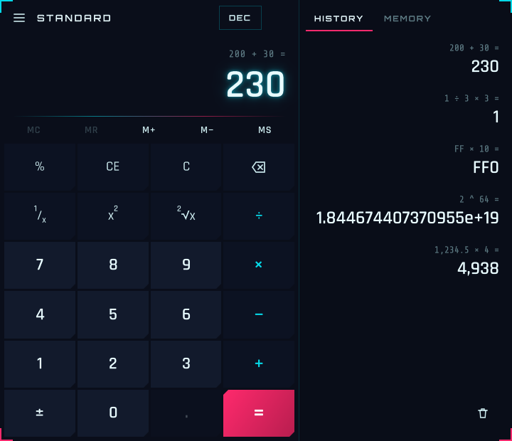

# CalcA

A calculator for the Linux desktop that works like the Windows calculator: simple and
clear in **Standard** mode, switchable to **Scientific**, with **DEC / HEX / BIN** in
both modes. Built with Qt 6 / QML in a dark cyberpunk look. Numbers are exact fractions
(GMP); functions such as sin, ln or Γ are computed with MPFR and rounded to 40 digits.

| Standard | Scientific | HEX |
|---|---|---|
|  |  |  |



## Features

- **Standard:** `%`, `CE`, `C`, `⌫`, `1/x`, `x²`, `√x`, `+ − × ÷`, `±`, decimal separator, `=`
  (pressing `=` again repeats the last operation)
- **Scientific:** `2nd`, `π`, `e`, parentheses, `xʸ`, `ʸ√x`, `10ˣ`, `2ˣ`, `log`, `logᵧx`,
  `ln`, `eˣ`, `n!`, `mod`, `exp`, `|x|`, DEG / RAD / GRAD, F-E, drop-downs for
  trigonometry (incl. inverse and hyperbolic) and functions (floor, ceil, rand, →dms, →deg)
- **DEC / HEX / BIN** switch in the header; HEX adds keys A–F, BIN allows only 0 and 1,
  integers of any size, grouped by four digits
- Exact arithmetic (`1 ÷ 3 × 3 = 1`, `25!` with all digits), numbers up to 10^10000
- Operator precedence in both modes (`2 + 3 × 4 = 14`)
- Memory (`MC MR M+ M− MS`) and history; from 640 px window width they stay visible on the right
- Full keyboard control (digits, `+ - * / ^ ( ) % !`, Enter, Backspace, Delete = CE,
  Esc = C, a–f in HEX), `Ctrl+C` / `Ctrl+V` copy and paste the number
- Follows the system language and number format: English, German, French, Italian,
  Spanish, Chinese (Simplified), Japanese
- Remembers mode, number system, angle unit and window size

## Install

Requires Qt 6.8 or newer, GMP and MPFR.

```sh
git clone https://github.com/arekown/CalcA.git
cd CalcA
./install.sh --deps      # installs the build dependencies (dnf, apt or pacman), then builds, tests and installs
```

If the dependencies are already there, `./install.sh` is enough. CalcA is installed for the
current user into `~/.local`; open the application menu and type `calc`.

| Command | What it does |
|---|---|
| `./install.sh` | build, test and install for the current user (`~/.local`) |
| `./install.sh --deps` | install the build dependencies first (uses `sudo`) |
| `./install.sh --system` | install for all users into `/usr/local` (uses `sudo`) |
| `./install.sh --prefix DIR` | install into `DIR` |
| `./install.sh --uninstall` | remove CalcA again (add `--system`/`--prefix` if you used it) |

### Dependencies

- **Fedora:** `sudo dnf install cmake ninja-build gcc-c++ pkgconf-pkg-config gmp-devel mpfr-devel qt6-qtbase-devel qt6-qtdeclarative-devel qt6-qttools-devel`
- **Debian / Ubuntu:** `sudo apt install cmake ninja-build g++ pkg-config libgmp-dev libmpfr-dev qt6-base-dev qt6-declarative-dev qt6-tools-dev qt6-tools-dev-tools qt6-l10n-tools qml6-module-qtquick qml6-module-qtquick-layouts qml6-module-qtquick-shapes qml6-module-qtquick-effects qml6-module-qtquick-window qml6-module-qtcore`
- **Arch:** `sudo pacman -S --needed cmake ninja gcc pkgconf gmp mpfr qt6-base qt6-declarative qt6-tools`

### Manual build

```sh
cmake -S . -B build -G Ninja -DCMAKE_BUILD_TYPE=Release -DCMAKE_INSTALL_PREFIX="$HOME/.local"
cmake --build build
ctest --test-dir build --output-on-failure
cmake --install build
```

## Development

- **Translations** are in `i18n/`. To add a language, add its code to `I18N_TRANSLATED_LANGUAGES`
  in `CMakeLists.txt`, run `cmake --build build --target update_translations` and translate the
  new `.ts` file (e.g. with Qt Linguist).
- **Screenshots** are rendered from the real UI: configure with `-DCALCA_BUILD_SCREENSHOTS=ON`
  and run `build/calca_screenshots screenshots` (needs a GPU-backed Qt platform, e.g. a running
  Wayland session or `kwin_wayland --virtual`).

## License

CalcA is licensed under the [PolyForm Noncommercial License 1.0.0](LICENSE): free for
personal and other noncommercial use, commercial use is not permitted.

It uses GMP and MPFR (LGPL, linked dynamically) and Qt (LGPL). The bundled fonts Orbitron,
Rajdhani and Share Tech Mono are under the SIL Open Font License (see `fonts/OFL-*.txt`).

---

## Deutsch

CalcA ist ein Taschenrechner wie unter Windows: einfach im Modus **Standard**,
umschaltbar auf **Wissenschaftlich**, mit **DEC / HEX / BIN** in beiden Modi.
Sprache und Zahlenformat richten sich nach dem System.

Installation: `./install.sh --deps` (installiert die Bau-Abhängigkeiten, baut, testet und
installiert nach `~/.local`); danach findet das Startmenü CalcA unter „calc“.
Entfernen: `./install.sh --uninstall`.

Lizenz: PolyForm Noncommercial 1.0.0 – privat und nicht-kommerziell frei nutzbar,
kommerzielle Nutzung nicht erlaubt.
